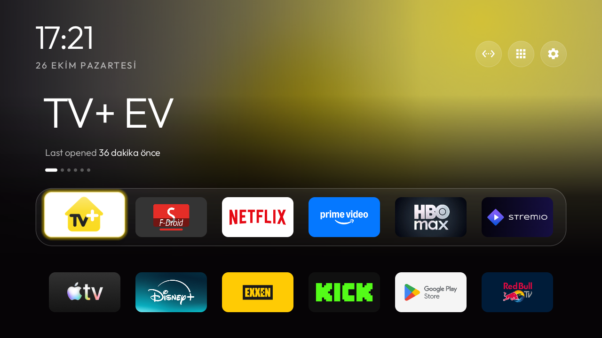

# HP5432 Android TV profili

TV+ HP5432 için, tek cihazda denenmiş debloat notları, CleanYourTV Glass yapılandırması ve geri dönüş rehberi.

**Durum: deneysel · v0.1.0 · 26 Ekim 2026 · bir cihazda aynı gün test edildi.** Uzun süreli kullanım ve farklı yazılım sürümleri henüz doğrulanmadı. Turkcell, Superonline, TV+, Google veya CleanYourTV ile resmî bağlantısı bulunmayan bağımsız bir çalışmadır.



## Neler içeriyor?

- İşlevi incelenerek kullanıcı 0 için kapatılan altı paketin açıklamalı profili.
- [CleanYourTV](https://github.com/Gathin23/cleanyourtv) kaynak sürümüne bağlı hazır Glass tema ayarları.
- Varsayılan ana ekranı etkin tutarak Home ve açılış yönlendirmesi için cihaz notları.
- Yerel profili doğrulayan, istenirse bağlı cihazı **yalnız okuyan** Python aracı. Elle uygulanacak paket komutlarının önizlemesi ayrıca seçilir.
- Kurulum, fiziksel test ve önceki ayarlara dönüş belgeleri.

Uygulama APK'ları, firmware, cihaz yedekleri, hesaplar, anahtarlar veya ham günlükler bu depoda bulunmaz. Araç kendiliğinden paket kapatmaz, uygulama kurmaz veya DNS değiştirmez.

## Denenen cihaz

| Alan | Değer |
|---|---|
| Model | SkyworthDigital HP5432 / HP4CD-TVplus |
| Android | Android TV 14, SDK 34 |
| Derleme | `UKG3.250826.001.P01.02.079_20260612` |
| Güvenlik yaması | 2026-04-05 |
| Bağlantı | Ethernet |
| Test kapsamı | Bir fiziksel kutu; aynı gün yeniden başlatma, yayın, ses, kanal, Home ve kumanda kontrolleri |

Tam derleme bilgisi [profilde](profiles/hp5432/profile.json), sonuçlar [test notlarında](docs/TESTED.md). Aynı modelde başka bir derleme için uyumluluk varsayılmamalı.

## Başlangıç

Python 3.11 veya üstüyle, proje klasöründe:

```powershell
python tools/profile.py
python -m unittest discover -s tests -v
```

Bu iki komut TV bağlantısı açmaz. Kurulum için [INSTALL.md](docs/INSTALL.md) belgesini izle. Önce cihaz/kampanya koşullarını ve [kapsamı](docs/SCOPE.md) değerlendir; her paket ayrı bir tercihtir. Sağlayıcı yönetim paketleri özellikle ayrıca değerlendirilmelidir.

ADB zaten bağlı ve TV ekranında yetkilendirilmişse salt okunur inceleme:

```powershell
$TvEndpoint = Read-Host 'TV ADB adresi (IP:port) veya USB hedefi'
python tools/profile.py --device $TvEndpoint --save
```

Yerel kayıt `.local/` altında tutulur ve Git tarafından dışlanır. Tam paket envanteri veya benzersiz cihaz kimliği alınmaz. Yalnız açıkça seçtiğin paketin elle uygulanacak komutlarını görmek için:

```powershell
python tools/profile.py --device $TvEndpoint --package com.google.android.feedback --show-commands
```

Bu da komutları **çalıştırmaz**. Başlangıç durumu zaten kapalı veya paket yoksa kapatma önerilmez. Önceki `default-state` ve açıkça `enable` durumları geri dönüşte ayrı tutulur. Daha önce var olan kapalı durumu değiştirmek amaçlanmaz.

## Görünüm ve uygulamalar

[Denenen Glass profili](themes/glass/config.json), TV+ EV, SmartTube F-Droid, Netflix, Prime Video, HBO Max ve Stremio'yu üst sıraya alır. Bu, kurulu uygulamalar için bir görsel tercihtir; paketleri yüklemez ve abonelik sağlamaz. Resmî YouTube test cihazında korundu.

SmartTube isteğe bağlıdır. Resmî YouTube kullanmak için `dock_apps` içindeki `app.smarttube.fdroid` değerini `com.google.android.youtube.tv` olarak değiştirip ilgili `app_labels` girdisini kaldırabilirsin. Bu düzenleme ayrıca kendi cihazında test edilmelidir. [Gizlilik ve hizmet koşulları notları](docs/SCOPE.md) dikkate alınmalı.

## Geri dönüş ve iş bitimi

[RECOVERY.md](docs/RECOVERY.md), ana ekran, paketler ve gizlilik ayarlarını önceki durumlarına döndürmeyi açıklar. Kendi cihazının başlangıç değerlerini sakla. Reklam kimliğini silmek eski kimliği geri getirmez; yeni kimlik oluşturulabilir.

Kurulum sonunda normal kumandayla kontrolleri yap; hata ayıklamayı kapat, bilgisayar yetkilerini kaldır ve yeniden başlat. Test cihazında bu işlemden sonra TV ağdayken bakım portunun bağlantıyı reddettiği doğrulandı.

## Kaynak ve lisans

Arayüz ve Glass tasarımı **Gathin / CleanYourTV** projesinden gelir; kullanılan kaynak: `f592b6d2db0cfa0e28779660f25ff65386a5ff9b`. Bu depodaki özgün belge ve araçlar MIT lisanslıdır. Kaynaklar, görsel ve üçüncü taraf bildirimleri için [THIRD_PARTY.md](THIRD_PARTY.md) ve [LICENSE](LICENSE) dosyalarına bak.

Sorun bildirirken yalnız model, derleme, seçilen paket ve kişisel bilgi içermeyen kısa sonucu paylaş. [Gizlilik notu](docs/PRIVACY.md).
